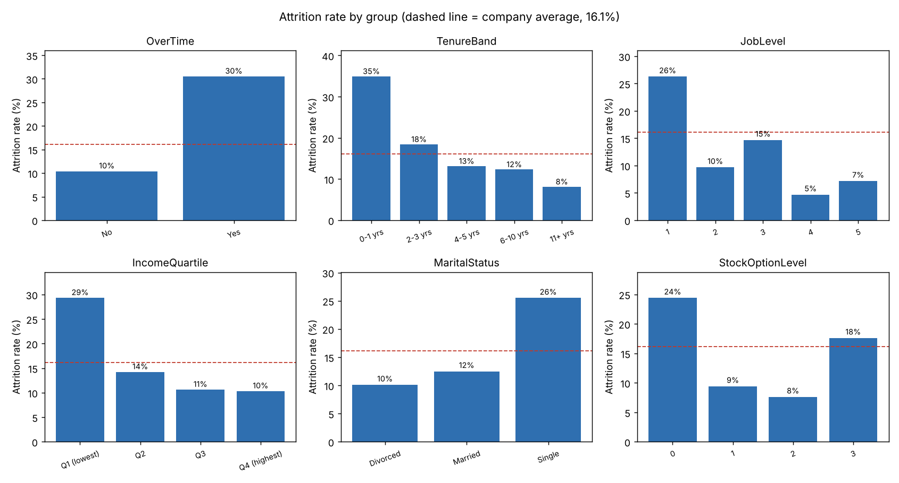

# Employee Attrition Analytics

Who leaves a company, and can we flag them early enough for HR to act?
An analysis of the IBM HR Analytics dataset (1,470 employees, 16.1% attrition)
with statistical tests, an honestly evaluated risk model, and an interactive
Streamlit dashboard.

**Live demo:** https://rohan-attrition-analytics.streamlit.app/

> **About the data:** the IBM HR Analytics dataset is fictional, created by IBM
> data scientists for teaching. It is a single snapshot, so it shows which
> groups have higher attrition, not what caused people to leave.

## Findings

Attrition rates by group, each tested with a chi-square test of independence
([`outputs/driver_tests.csv`](outputs/driver_tests.csv)):

| Factor | Higher-risk group | Comparison | p-value |
|---|---|---|---|
| **Overtime** | Works overtime: **30.5%** | No overtime: 10.4% | < 0.001 |
| **Overtime + entry level** | Job level 1 on overtime: **52.6%** (156 people) | Company: 16.1% | — |
| **Tenure** | First year (0–1 yrs): **34.9%** | 11+ yrs: 8.1% | < 0.001 |
| **Job role** | Sales Representative: **39.8%**, Lab Technician: 23.9% | Research Director: 2.5% | < 0.001 |
| **Income** | Lowest quartile: **29.3%** | Highest quartile: 10.3% | < 0.001 |
| **Stock options** | None (level 0): **24.4%** | Level 1–2: 7.6–9.4% | < 0.001 |
| **Marital status** | Single: **25.5%** | Divorced: 10.1% | < 0.001 |
| **Business travel** | Frequent: **24.9%** | None: 8.0% | < 0.001 |

- **Overtime is the single strongest signal.** Overtime staff are 28.3% of
  employees but **53.6% of leavers**. It stays the strongest factor after
  controlling for everything else in the model: overtime multiplies the
  odds of leaving by about 5.
- **No difference** by gender (p = 0.29), education (p = 0.55) or
  performance rating (p = 0.99). Notably, **high performers leave as often as
  everyone else**.



### Recommendations

1. **Review overtime in entry-level roles first.** Half of entry-level staff
   who work overtime leave; this is the most concentrated risk in the data.
2. **Strengthen the first year.** A third of first-year employees leave;
   structured onboarding and check-ins at 3, 6 and 12 months target it directly.
3. **Look at Sales Representative and Laboratory Technician roles.** They
   have the two lowest median monthly incomes (2,579 and 2,886 vs. a company
   median of 4,919) alongside high attrition.
4. **Use stock options as a retention lever.** Employees with none leave
   at 2–3× the rate of those at levels 1–2. (Level 3's higher rate rests on
   only 85 people.)
5. **Measure the effect.** Because the data is a snapshot, these are
   associations. Any change should be piloted on one group and compared
   with a similar group that didn't receive it.

## Risk model: evaluated honestly

Only 16% of employees leave, so predicting "nobody leaves" is already 84%
accurate while catching zero leavers. Accuracy is therefore the wrong
headline. On a held-out, stratified 25% test set (368 employees, 59 leavers):

| Model | Leavers caught (recall) | Precision | ROC-AUC | Accuracy |
|---|---|---|---|---|
| Baseline: predict everyone stays | 0 of 59 (0%) | — | 0.50 | 84.0% |
| **Logistic regression (class-balanced)** | **37 of 59 (63%)** | 38% | **0.81** | 77.4% |
| Random forest (class-balanced) | 30 of 59 (51%) | 48% | 0.78 | 83.4% |

5-fold cross-validated ROC-AUC: logistic regression 0.82 ± 0.02, random
forest 0.81 ± 0.03. Logistic regression was chosen: it catches the most
leavers, and its coefficients are directly interpretable.

**Trade-off:** the model flags 61 employees who stay alongside the 37 who
leave. That's acceptable for a screening aid that prompts an HR
conversation, but not for any decision about an individual.

### Revision notes (October 2026)

An earlier version headlined 86% accuracy. On that version's own test
split, simply predicting "nobody leaves" scored 86.7%, and its models
caught only 5 of 39 leavers. It also label-encoded unordered categories, and its dashboard
filled every unset field with the first employee's data. This version:
- one-hot encodes nominal categories and scales numeric features
- uses a stratified split and class balancing
- reports recall, precision, ROC-AUC and a baseline instead of accuracy alone
- starts the what-if tool from a typical (median / most common) employee.

## Dashboard

```bash
pip install -r requirements.txt
streamlit run app/app.py
```

1. **Who leaves?** Attrition rate by any factor, filterable by department.
2. **How reliable is the model?** Test-set recall, precision and ROC-AUC next to the baseline.
3. **What-if:** risk score for an adjustable employee profile.

## Reproduce the analysis

```bash
python analysis/drivers.py            # attrition rates + chi-square tests + chart
python analysis/model_evaluation.py   # baseline vs. models, cross-validation, coefficients
```

## Project structure

```
employee-attrition-dashboard/
├── attrition_lib.py          # shared loading, features and model pipeline
├── analysis/
│   ├── drivers.py            # who leaves: rates and significance tests
│   └── model_evaluation.py   # honest model evaluation
├── app/app.py                # Streamlit dashboard
├── data/                     # IBM HR Analytics CSV
├── outputs/                  # generated tables and chart
└── requirements.txt
```

## Tech stack

Python · pandas · SciPy · scikit-learn · Plotly · Matplotlib · Streamlit
